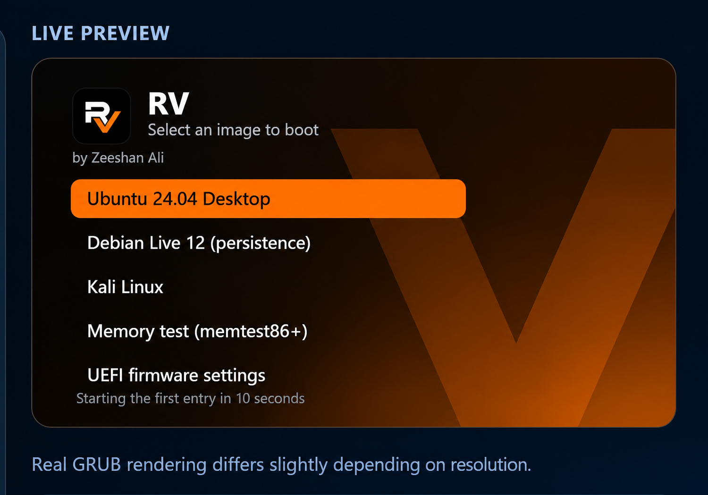

# RV - multiboot USB creator for Windows
*by Zeeshan Ali*

* Single `RV.exe` (Go, no installer, no dependencies). Run it, accept the UAC prompt, done.
* Make a bootable USB drive from your phone when your PC/laptop is broken or Operating System crash or corrupt.
 

## What it does
* **Create** - wipes a USB drive and builds an RV multiboot drive:
  `[data: exFAT/NTFS/FAT32] [boot: FAT32 + GRUB2] [optional casper-rw] [optional persistence]`
  Boots on BIOS and UEFI (Secure Boot must be off).
* **Drive** - add / delete ISO files, free-space meter, re-install the boot loader (ISOs untouched).
* **Boot menu** - 6 themes (default "RV Orange" = icon colours), title, timeout, resolution,
  default entry, ISO folders, extra entries (memtest86+, internal disk / Windows, UEFI setup,
  restart, shut down), live preview.
* **Persistence** - ext2 partitions labelled `casper-rw` (Ubuntu, Mint, Pop!_OS ...) and
  `persistence` + `persistence.conf` (Debian Live, Kali ...). "(persistence)" entries are generated automatically.
* **Windows installer mode** - single Windows 10/11 ISO -> FAT32 UEFI+BIOS installer
  (splits install.wim > 4 GB via DISM, optional Win11 TPM/Secure Boot/RAM bypass).
* **Flash** - DD mode for hybrid ISOs / .img with read-back verification.
* App themes (same 6 palettes), animations on/off.

## How ISOs are booted
GRUB scans the data partition (`/` and `/ISO` by default). Each ISO is inspected:
`boot/grub/loopback.cfg` (Ubuntu, Mint, Kali ...) is used as-is; otherwise built-in recipes for
casper, Debian live, Arch, Fedora. Windows ISOs are not bootable from the menu - use Windows mode.

## Known limits
* Secure Boot is not supported (GRUB is not signed). Disable it in firmware.
* MBR layout: only the first 2 TB of a bigger drive is used. 4Kn (4096-byte sector) drives are refused.
* Persistence is reserved when creating the drive (cannot be added afterwards).
* Windows ISOs cannot be booted from the multiboot menu.
* Recipes for distros other than Ubuntu/Debian-style were not boot-tested.
* The Windows-specific code (diskpart, raw disk writes, PowerShell, Edge window) could not be run on real
  Windows during development. Test on a spare USB stick first.

## Build from source (Linux)
    ./build/build_grub.sh && python3 build/build_themes.py
    x86_64-w64-mingw32-windres --preprocessor=cat -O coff -i winres/rv.rc -o rsrc_windows_amd64.syso
    GOOS=windows GOARCH=amd64 CGO_ENABLED=0 go build -trimpath -ldflags "-s -w -H=windowsgui" -o RV.exe .

Dev mode on Linux (disk image files instead of real drives):
    RV_DEV_DISKS=/path/a.img RV_DEV_DATA=/some/dir go run . -no-window
`tests/` has the QEMU scripts used for verification.

### Download for Windows
 
 https://download1654.mediafire.com/ozmcz67gtbjgnefM0UtvM7ZJ49ylkUY-R3fMiXSBG--hVRANy_Li97KJSL7jMnx3KZ-taLPzeBXjIw4Bks5pY6RLSNPTxTN_R6ZigNyD3lY-vWZZ3G9bc6a2W3e-bbMY7Cl5hxKqEtb6JdkEttGgZNWXLR0bxIl2VkyJ6r9NfYpEACGFUQ/o9q5d460cwlrkqf/RV.exe

### Download for Android 

https://download856.mediafire.com/5b8vbkn5blmguUfBIocHO7sVu8kXbJJzRCUEEO2MBjv6OLdB9Uh565pDe-fAeZbGKHTF96EOEFTArHudDh5-lo-02AvTOazqJibDK5zcYG3qVxU1axnWQbZ-KprREJB0YHYPBK7JbY4LzDLzXoJiR9yeQPvkjepgHC2Zx9L58pO0O4oR_A/nvftknhu903ztp8/RV.apk

### Speacial Thank

* Rizwan Ali (Help) 
* Emaan Fatima (Inspiration)
  
